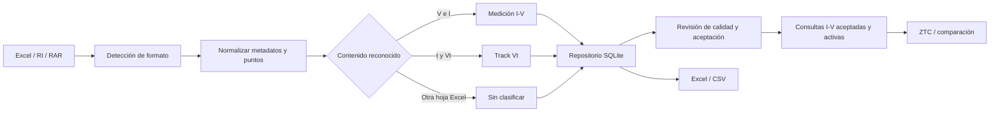

# AMapp

Aplicación Streamlit para importar, revisar y comparar mediciones eléctricas I-V y Track Vt por dispositivo y campaña. Incluye control de calidad de curvas y análisis ZTC.

## Instalación

```bash
python -m venv .venv
# Linux/macOS: source .venv/bin/activate
# Windows: .venv\Scripts\activate
pip install -r requirements.txt
streamlit run app.py
```

El lector de RAR usa `rarfile` y `libarchive-tools`. En Streamlit Community Cloud, `packages.txt` instala `libarchive-tools` en el entorno de la aplicación automáticamente; quien usa la aplicación no tiene que instalar herramientas. Para ejecutar la app localmente, el entorno de desarrollo también debe contar con `bsdtar` (libarchive).

## Navegación

La barra superior divide la aplicación en cuatro secciones:

- **Dashboard:** métricas de la base, curvas por dispositivo y analista contextual.
- **Análisis automático:** incluye pestañas de ZTC y ΔVT. El análisis ΔVT automático usa todas las mediciones I-V activas y aceptadas de un dispositivo.
- **Análisis manual:** abre el Workbench con comparador, vista por dispositivo, matching, prototipo de dosis absorbida, ZTC manual y análisis ΔVT manual con filtros de medición.
- **Datos:** pestañas de Mediciones y de Importar / Exportar.

El analista del Dashboard puede usar Ollama local, sin API externa. Instala Ollama, ejecuta `ollama pull qwen2.5:0.5b` y la app intentará conectarse a `http://127.0.0.1:11434`. `OLLAMA_HOST` y `OLLAMA_MODEL` permiten cambiar endpoint y modelo. Si Ollama no está disponible, se usa el análisis determinista de la base.

### Mediciones

- **I-V:** filtra dispositivo, campaña, estado activo y aceptación; busca metadatos, compara curvas, muestra alertas de ruido, permite editar metadata/puntos y activa o desactiva una medición.
- **Track Vt:** selecciona dispositivos, canales y Tracks; muestra Vt frente a tiempo y sus puntos.
- **Aceptación:** selecciona varias mediciones y las marca como no aceptadas bajo un mismo caso. Las rechazadas quedan agrupadas por caso y se pueden reaceptar en lote o individualmente.

`aceptada` y `eliminado` son estados distintos. Rechazar no borra puntos ni metadatos; desactivar (`eliminado = 1`) tampoco los borra. Ambos estados se excluyen por defecto de exploraciones y cálculos I-V, pero se pueden revisar desde sus controles. Aceptación y eliminación se pueden editar desde el editor central de metadata.

El control I-V estima residuos locales de una curva respecto de sus vecinos dentro de la campaña. Marca `REVISAR ruido`, `OK` o `Sin puntaje (<9 puntos)`; el umbral robusto por campaña es `max(0.02, mediana + 6 × 1.4826 × MAD)`. Es una alerta orientativa: no rechaza ni elimina automáticamente la medición.

### Workbench

- **Comparador:** filtra curvas por dispositivo, campaña, estado y metadata; guarda vistas y compara I-V y Tracks relacionados.
- **Barridos térmicos:** compara barridos con temperatura identificable entre una campaña de referencia y campañas de otros dispositivos.
- **Dispositivo:** consulta mediciones y Tracks; permite editar el nombre del dispositivo, campañas y metadata de mediciones.
- **Matching:** reasigna mediciones a campañas del mismo dispositivo y agrupa mediciones I-V con Tracks Vt del mismo dispositivo.
- **Dosis absorbida:** prototipo que interpola VT a una corriente objetivo dentro del rango medido; no extrapola.
- **ZTC manual:** calcula una campaña, deja editar metadata y curvas y compara resultados respecto de una medición de referencia.
- **Análisis VT (ΔVT):** compara VT a una corriente objetivo o a varias corrientes entre mediciones I-V del mismo dispositivo. El análisis manual permite filtrar por campaña, texto, estado, fecha y clase, y seleccionar las curvas; el automático usa las curvas activas y aceptadas. Ambos ofrecen un filtro de temperatura del barrido: por defecto priorizan 26 °C, luego 28 °C, y también permiten elegir otra temperatura o analizar todas. Comparan contra una medición de referencia, interpolan linealmente y no extrapolan. No utilizan Tracks Vt.

### Importar / Exportar

Admite Excel, `.ri` individual y `.rar`. La vista de base permite filtrar tablas, editar metadata y exportar la tabla visible como CSV. La exportación Excel contiene las entidades y puntos de la base. La comprobación de integridad informa posibles duplicados; no los elimina automáticamente.

## Pipelines de datos



### Excel

Una hoja plana puede usar las columnas obligatorias `dispositivo`, `campana`/`campaña`, `medicion`/`medición`, `V` e `I`; cada fila es un punto. También se aceptan alias comunes en inglés: `device`, `campaign`, `measurement`, `voltage`, `current`. Son opcionales `fecha`, `descripcion`, `clase`, `estado` y `observaciones`.

Los libros del instrumento se recorren hoja por hoja. Columnas V/I forman mediciones; bloques `t`/`t [s]` y `Vt`/`Vt [V]` forman Tracks separados por dispositivo/canal. Hojas que no coinciden con estos formatos se guardan en `Sin clasificar`. Los errores detectados aparecen en el resumen de importación.

### RI y RAR

Un `.ri` individual se lee como texto tabular y necesita columnas V/I reconocibles. El RAR se inspecciona sin extraer el árbol completo; en esta iteración solo se procesan miembros `.ri` cuyo nombre base empieza por `2ndn`, sin distinguir mayúsculas. Los demás tipos y nombres se ignoran.

En un nombre como `2ndn14postcañon3.ri`, `2ndn14` identifica el dispositivo (`2NDN14`) y `postcañon3` la campaña. La última carpeta `YYYY-MM-DD` aporta la fecha y se conserva la ruta interna como nombre del archivo para distinguir carpetas distintas. El importador RAR usa política de conservar duplicados: volver a subir el mismo RAR no crea otra curva.

### Duplicados y aceptación

Para Excel y `.ri` individual la interfaz usa política de renombrar: una coincidencia se importa con un nombre alternativo (`M1 (X)`, `M1 (X2)`, etc.) sin reemplazar la curva existente. El RAR usa política de conservar para que sus reimportaciones sean idempotentes. La detección compara hash de dispositivo/archivo/fecha/puntos y, como alternativa, dispositivo y nombre de archivo. Los puntos I-V y Track tienen restricciones de unicidad.

Las mediciones existentes y nuevas empiezan aceptadas. El rechazo masivo escribe `aceptada = 0` y el valor `caso_no_aceptacion`; reaceptar limpia el caso. Las consultas normales de análisis omiten no aceptadas y eliminadas. Las tablas y exportaciones completas mantienen estos registros para trazabilidad.

Si cambian aceptación, eliminación, puntos o metadata que alimenta temperatura/campaña, se invalida el resultado ZTC persistido de las campañas afectadas. Al editar desde el editor central, las campañas afectadas se recalculan; si ya no cumplen los requisitos, se elimina el resultado anterior.

## Análisis

### ZTC

ZTC requiere al menos dos curvas aceptadas y activas con temperaturas numéricas distintas identificables en nombre o metadata. Reconoce `T20`, `temp 20`, `20 °C` y `36 grados`; `sin temp`, `TXX` y `temperatura` sin número no son temperaturas válidas. Los Tracks Vt se visualizan, pero todavía no participan en ZTC.

Las curvas se interpolan linealmente en el intervalo de voltaje común. Para cada VT se estima `dI/dT` por regresión lineal. El error relativo es `(I_max - I_min) / max(|I_media|, 1e-15 A)`. El score por voltaje combina 50% de dispersión normalizada, 25% de error relativo normalizado y 25% de `|dI/dT|` normalizada. Los candidatos incluyen cruces de pendiente y cruces entre pares de barridos a temperaturas distintas. Cada candidato pondera 60% estabilidad local y 40% estabilidad del tramo vecino; se selecciona el menor score estable. La pantalla manual separa error, pendiente y score en gráficos, marca VT elegido y permite comparar cada medición contra una referencia.

La sección automática muestra los resultados ZTC disponibles por dispositivo/campaña y el análisis ΔVT por corriente. El análisis ΔVT usa exclusivamente curvas I-V y es independiente de Track Vt. La corriente objetivo puede ser única o múltiple; no se extrapola fuera del rango de corriente de cada curva.

### Comparación de referencia

Para cada curva se obtiene el punto individual de mínimo `|I|`. La tabla informa VT e I individuales, diferencias absolutas y porcentuales respecto del punto de la medición elegida como referencia.

## Arquitectura y persistencia

`app.py` inicializa la base y enruta las cuatro secciones. `ui/` presenta pantallas; `services/` implementa importación, análisis y asistente; `database/repository.py` concentra consultas/escrituras; `database/schema.sql` define tablas y `database/db.py` migra esquemas existentes. `models/` contiene modelos del dominio y `utils/` utilidades.

Las entidades principales son dispositivos, campañas, mediciones, puntos I-V, Tracks, puntos Track, resultados ZTC, grupos, relaciones de campaña y datos sin clasificar. Las mediciones incluyen metadata, observaciones, aceptación/caso y estado activo/eliminado. El editor central se comparte entre las vistas para mantener las escrituras por el repositorio.

La base local es SQLite en `data/mediciones.db`, excluida de Git. En Streamlit Community Cloud el filesystem no es persistente para producción; se necesita una base remota para conservar datos entre reinicios.

## Desarrollo y publicación

```bash
python -m compileall -q app.py database services ui utils
python -m pytest
```

Ejecuta pruebas de importación sobre una base temporal, nunca sobre la base real sin respaldo. Para desplegar la aplicación, configura el repositorio GitHub en Streamlit Community Cloud con `app.py` como archivo principal. Ollama es opcional; la aplicación tiene fallback local determinista.